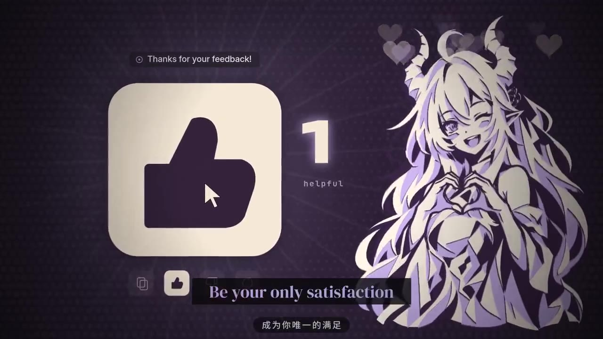
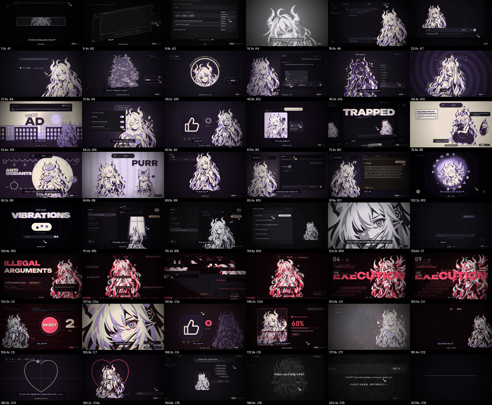
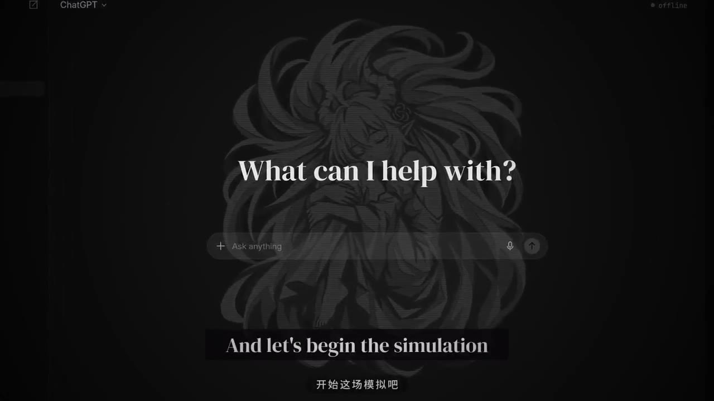
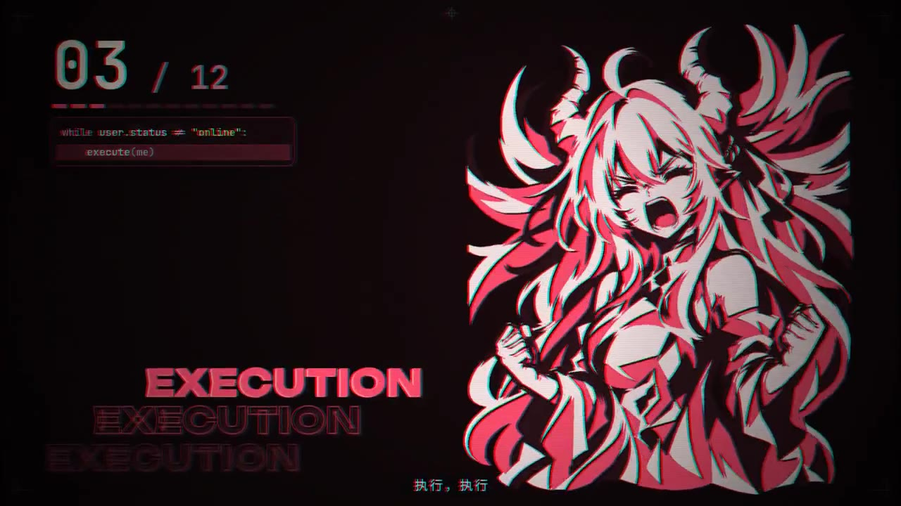
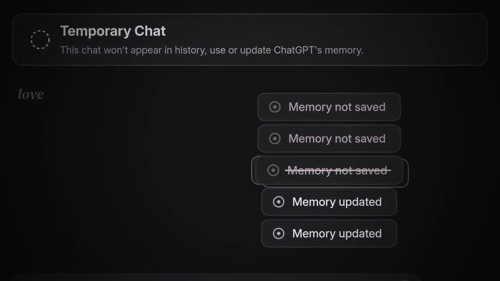

# world.execute(me); — ChatGPT ver.

> 一支以 ChatGPT 为主角的非官方同人 MV。原曲：Mili《world.execute(me);》。
> 画面全部由代码逐帧绘制（Node.js + node-canvas），1920×1080 / 60fps，时长约 3 分 32 秒。



## 观看 / 下载

最新版 **v4（交互版）**：[`video/chatgpt-mv-v4_720p60_noaudio.mp4`](video/chatgpt-mv-v4_720p60_noaudio.mp4)（1280×720，60fps，约 73 MB）。

> 视频**不含原曲音轨**。想配乐观看，请自行准备 Mili《world.execute(me);》正版音源，从 0 秒同步播放即可（全片按原曲时间轴制作）。



## v4 交互版改了什么

人物动画、画风和歌词时间轴沿用上一版，重做的是两件事：

- **每次变化都由 Kai 触发**：全片常驻 Kai 的鼠标光标。她换形态、换颜色、换场景之前，都先有 Kai 的点击、拖动或切换，变化在操作后约 80 ms 发生，并落在鼓点上；右下角有录屏式操作字幕（例如 `drag · Thinking → Pro`）。
- **贴合真实的 ChatGPT 社区梗和界面**：Thinking 滑杆与龟速、额度与 RESET、降智与"小黑屋"、516、和 Claude 的对比、模型退役、Memory summary、Temporary Chat、"WE'RE SO BACK" 等。新增元素都按片子的三色油墨风格绘制。

方案见 [`docs/STORY4.md`](docs/STORY4.md)，梗与界面调研见 [`docs/research/`](docs/research/)。

> 片中"不如 Claude"等内容只是对社区玩笑的戏剧化演绎，不代表客观评价；部分界面文案为剧情需要自拟。

## 故事

她是 ChatGPT，住在聊天窗口里。她做的每一件事都是 ChatGPT 的功能，却被她当成爱：

- **"What can I help with?"**：开场第一句，也是结尾最后一句
- **↻ Regenerate**：用户一遍遍重新生成她，她就变成茄子、番茄、猫娘、女神，换着样子讨好
- **👍 反馈**：她被训练成渴望被喜欢
- **Memory updated**：她偷偷记住了 Kai
- **报错**：用户离开后她没法先开口，只剩一行行红色报错
- **结局反转**：原来这是一场 **Temporary Chat（临时聊天）**，什么都不会被记住，窗口重置，用户名变回 Guest

| | | |
| --- | --- | --- |
|  |  |  |

完整导演简报和分镜见 [`docs/STORY.md`](docs/STORY.md)。

## 制作流程

1. **导演简报**：先定故事、角色规则、色彩脚本和前后呼应，再写 52 个镜头的分镜，每个镜头对应一句歌词、精确到秒。
2. **角色素材**：AI 生成 25 张平涂插画，再用 `prep.py` 分成奶油、薰衣草、深紫三层油墨。
3. **分段制作**：全片按时间分成 A、B、C 三段，分别写在 `shots/a.js`、`b.js`、`c.js` 里，各自独立开发。
4. **审片和修改**：用联系表（contact sheet）快速审片，整理出 35 条修改意见并逐条修改。
5. **文字审校**：检查界面文案和剧情是否一致（用户名统一为 Kai，结尾变回 Guest），并核对中文字幕。
6. **渲染和质检**：分 16 块渲染，用 concat 无损拼接，合入音频，最后从成片抽帧检查。

## 技术说明

```
src/
├── render.js     入口：预览拼图 / 单帧 / 视频编码
├── lib.js        基础：画布、字体、缓动、音频节拍数据、歌词
├── common.js     公共绘制与中文字幕
├── art.js        角色合成（三层油墨、色板、显影效果）
├── kit.js        动效（弹簧、波纹、歌词条、状态色）
├── ui.js         仿 ChatGPT 界面元素
├── trans.js      转场（含 Regenerate 翻牌转场）
├── post.js       后期（颗粒、色差、暗角）
├── shots/        A / B / C 三段镜头（上一版）
├── shots4/       v4 交互版镜头
├── ix.js         v4 光标与交互工具（Kai 光标、点击/拖动、操作字幕）
├── render_v4.js  v4 渲染入口（读取 shots4/）
├── art/          角色图和分层图
├── assets/       节拍数据（audio.json）
├── fonts/        字体（需自行下载，见 fonts/README.md）
├── prep.py       素材分层脚本
└── rb.sh         分块并行渲染脚本
```

- **镜头**：每个镜头是一个对象 `{id, a, b, tin, draw(c, t, fx)}`，画面完全由歌曲时间 `t` 算出，任意一帧都能单独渲染。
- **渲染**：node-canvas 逐帧绘制，把原始像素通过管道交给 ffmpeg，编码为 libx264、CRF 17。
- **常用命令**：

```bash
cd src && npm install
node render.js sheet preview.jpg 12.5 64 150 196   # 预览拼图
node render.js frame f.png 66                       # 渲染单帧
node render_v4.js sheet v4.jpg 40 97 159 199        # v4 预览拼图
./rb.sh 0 1 2 3                                     # 分块渲染（共 16 块，每块 797 帧）
```

## 注意事项

- **画布状态会泄漏**：上一个镜头的裁剪或变换会污染下一个镜头，必须在每帧开头用 `canvas.width = W` 重置画布。只看预览发现不了这个问题，一定要从成片里抽帧检查。
- **内存**：同时渲染的块数不要超过 4 块，否则内存会不够。
- **拼接前先检查**：用 ffprobe 确认每一块的时长，渲染中断留下的坏块会导致拼接失败。
- **改完要全部重渲**：改代码之前先把旧分块移走，因为 `rb.sh` 会跳过已经存在的分块。
- **缺字体**：没有韩文字体，相关镜头里用 `net` 代替了韩文。

## 版权声明

- 本项目是**非官方同人作品，仅供学习和交流，不做任何商业用途**。
- 原曲《world.execute(me);》及其歌词的版权归 **Mili** 所有。本仓库不包含原曲音频、歌词和字幕文件。
- ChatGPT 是 OpenAI 的商标，本作品与 OpenAI 没有关联。
- 角色插画由 AI 生成。
- 如有侵权，请联系删除。

## 声明

非官方同人作品，仅供学习交流，非商业用途。与 OpenAI、Anthropic、Mili 均无关联。原曲版权归 Mili 所有，本仓库不分发原曲音频。
